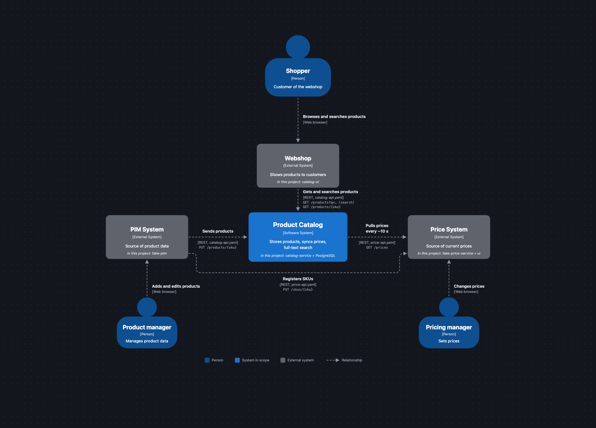
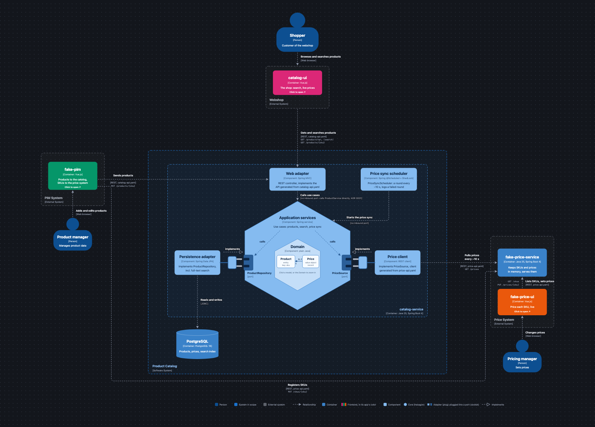
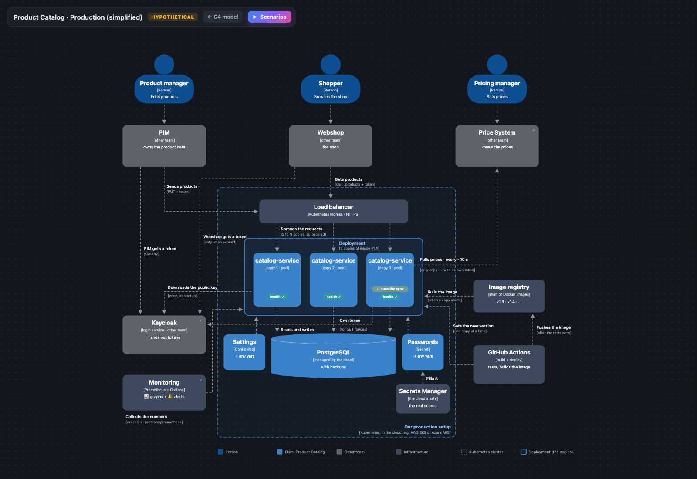

# Product Catalog API

[](https://github.com/mikebg95/product-catalog/actions/workflows/ci.yml)

A REST microservice that stores the products of a webshop, keeps their prices in sync with an external price system, and offers full-text search across all product characteristics in well under a second.

Built for the JDriven technical assessment "Real-time Product Catalog API".



*System context (C4 level 1). Interactive version: [`docs/diagrams/c4-model.html`](docs/diagrams/c4-model.html)*

## Contents

- [What it does](#what-it-does)
- [Quick start](#quick-start)
- [Try it out](#try-it-out)
- [Architecture](#architecture)
- [Running in production](#running-in-production)
- [Design decisions](#design-decisions)
- [Building and testing](#building-and-testing)
- [Configuration](#configuration)
- [Project structure](#project-structure)
- [Known limitations](#known-limitations)

## What it does

| Requirement | How | Decision |
|---|---|---|
| Store products and expose them through REST | `catalog-service`: Spring Boot, PostgreSQL, a contract-first OpenAPI | [ADR 2](docs/adr/0002-contract-first-openapi.md), [ADR 4](docs/adr/0004-postgresql-and-flyway.md) |
| Products come from an external system | The PIM sends `PUT /products/{sku}`: create or replace, safe to retry | [ADR 3](docs/adr/0003-put-products-by-sku.md) |
| Robust price sync | The catalog pulls all prices every ~10 s, with timeouts and retries, and only applies prices newer than the ones it has. It keeps its last known prices while the price system is down. | [ADR 7](docs/adr/0007-scheduled-pull-for-price-sync.md) |
| Full-text search, one input field, under 1 s | PostgreSQL full-text search with a GIN index over every field, attributes included. Under ~240 ms with 1,000,000 products. | [ADR 5](docs/adr/0005-core-fields-plus-jsonb-attributes.md), [ADR 6](docs/adr/0006-postgresql-full-text-search.md) |
| Deployment-ready | Docker images, settings from environment variables, health probes, Flyway migrations, CI, safe to run as several copies, Prometheus metrics | [ADR 8](docs/adr/0008-shedlock-for-the-price-sync.md), [ADR 10](docs/adr/0010-docker-compose-and-github-actions.md) |

**In scope:** `catalog-service` and its PostgreSQL database. Everything else in this repo stands in for systems that other teams own, so the whole flow can be demoed:

| Stand-in | Plays the role of |
|---|---|
| `fake-pim` | The PIM, where products are entered |
| `fake-price-service` + `fake-price-ui` | The price system, where prices are set |
| `catalog-ui` | The webshop, which uses the catalog's API |

## Quick start

**Prerequisites:** Docker with Docker Compose. Nothing else: Java, Maven and Node.js run inside the containers.

```bash
git clone https://github.com/mikebg95/product-catalog.git
cd product-catalog
docker compose up -d --build
docker compose ps    # wait until catalog-service and fake-price-service are "healthy"
```

| What | URL |
|---|---|
| Catalog API (Swagger UI) | http://localhost:8080/swagger-ui.html |
| Catalog health | http://localhost:8080/actuator/health |
| Webshop (`catalog-ui`) | http://localhost:3000 |
| PIM (`fake-pim`) | http://localhost:3001 |
| Price system (`fake-price-ui`) | http://localhost:3002 |
| Price system API (Swagger UI) | http://localhost:8081/swagger-ui.html |
| Grafana dashboard | http://localhost:3003 |
| Prometheus | http://localhost:9090 |

Compose runs two copies of the catalog (`catalog-service` and `catalog-service-2`), like in production. Only the first one has a port.

To stop: `docker compose down`. This also removes the database, so the next start is empty.

## Try it out

**In the browser:**
1. Open the PIM (http://localhost:3001) and click **Load demo products**.
2. Open the webshop (http://localhost:3000): the products are there, without a price.
3. Open the price system (http://localhost:3002) and set a price.
4. Within ~10 seconds the price shows up in the webshop.

**With curl:**

```bash
# create or replace a product (no price: only the price sync sets prices)
curl -X PUT http://localhost:8080/products/SHOE-RED-42 \
  -H 'Content-Type: application/json' \
  -d '{"name": "Running shoe", "brand": "Acme", "category": "Shoes",
       "description": "Lightweight running shoe", "attributes": {"color": "red", "size": 42}}'

# get one product
curl http://localhost:8080/products/SHOE-RED-42

# search across all fields, partial words allowed
curl 'http://localhost:8080/products?q=red%20sho'

# give the product a price in the price system, then wait ~10 s and get it again
curl -X PUT http://localhost:8081/skus/SHOE-RED-42
curl -X PUT http://localhost:8081/prices/SHOE-RED-42 \
  -H 'Content-Type: application/json' -d '{"amount": 89.95}'
```

**Endpoints** (full contract: [`catalog-api.yaml`](catalog-service/src/main/resources/openapi/catalog-api.yaml)):

| Method | Path | What |
|---|---|---|
| `PUT` | `/products/{sku}` | Create or replace a product (`201` created, `200` replaced) |
| `GET` | `/products/{sku}` | One product (`404` if unknown) |
| `GET` | `/products?q=&page=&size=` | List all products by SKU, or search with `q` (best match first). Pages of up to 100. |

Errors use the standard Problem format ([RFC 9457](https://www.rfc-editor.org/rfc/rfc9457)).

**With a million products:** `./scripts/seed-million.sh` adds 1,000,000 generated products straight into PostgreSQL, to check the search speed. Each search's time is shown in the webshop and sent in the `Server-Timing` response header.

## Architecture



*Components (C4 level 3). Interactive version, with step-by-step request flows: [`docs/diagrams/c4-model.html`](docs/diagrams/c4-model.html)*

- **Lightweight hexagonal** ([ADR 1](docs/adr/0001-lightweight-hexagonal-architecture.md)): the domain (`Product`, `Price`) is plain Java with no Spring, database or HTTP. The database and the price system plug in through ports (`ProductRepository`, `PriceSource`). ArchUnit tests enforce the boundaries.
- **Price sync** ([ADR 7](docs/adr/0007-scheduled-pull-for-price-sync.md)): `PriceSyncScheduler` → `PriceSyncService` → `PriceSource` (the HTTP client). Unknown SKUs and invalid prices are skipped, and a price is only saved if it's newer. A failed round is logged and retried on the next one.
- **Several copies** ([ADR 8](docs/adr/0008-shedlock-for-the-price-sync.md)): ShedLock (a lock table in PostgreSQL) makes sure only one copy runs each sync round. If that copy dies, another takes over.

## Running in production

A design, not built: how the same image would run on a shared Kubernetes platform, next to the other teams' services.



*Production view (hypothetical). Interactive version, with scenarios like a deploy or a crash: [`docs/diagrams/production-diagram.html`](docs/diagrams/production-diagram.html)*

- Several copies behind a load balancer, scaled automatically, updated one at a time without downtime.
- Settings from a ConfigMap, passwords from the cloud's secret store, both as environment variables: the same image as in docker-compose.
- A managed PostgreSQL with backups, OAuth2 tokens for the PIM and the webshop, and Prometheus and Grafana with alerts.

The diagrams are HTML pages: clone the repo and open them in a browser.

## Design decisions

Each big decision is written down as an Architecture Decision Record in [`docs/adr`](docs/adr/README.md): what I chose, why, what I didn't choose, and when I'd revisit it.

| # | Decision | Not chosen |
|---|---|---|
| [1](docs/adr/0001-lightweight-hexagonal-architecture.md) | Lightweight hexagonal architecture | Classic layers, strict hexagonal |
| [2](docs/adr/0002-contract-first-openapi.md) | Contract-first OpenAPI | Code-first |
| [3](docs/adr/0003-put-products-by-sku.md) | Products come in with `PUT /products/{sku}` | `POST` + generated ID |
| [4](docs/adr/0004-postgresql-and-flyway.md) | PostgreSQL and Flyway | MongoDB, Liquibase |
| [5](docs/adr/0005-core-fields-plus-jsonb-attributes.md) | Core product fields plus flexible attributes (JSONB) | Fixed columns, key/value table |
| [6](docs/adr/0006-postgresql-full-text-search.md) | PostgreSQL full-text search | Elasticsearch |
| [7](docs/adr/0007-scheduled-pull-for-price-sync.md) | Scheduled pull for the price sync | Webhooks, Kafka |
| [8](docs/adr/0008-shedlock-for-the-price-sync.md) | ShedLock: one price sync, also with several copies | One copy, Quartz, leader election |
| [9](docs/adr/0009-testing-against-real-dependencies.md) | Testing against real dependencies: Testcontainers and WireMock | H2, mocked HTTP client |
| [10](docs/adr/0010-docker-compose-and-github-actions.md) | Dockerfile, docker-compose and GitHub Actions | Buildpacks, Kubernetes, Jenkins |

## Building and testing

**Prerequisites:** JDK 25 and Docker (the tests start PostgreSQL with Testcontainers). Maven comes with the wrapper.

```bash
cd catalog-service
./mvnw verify
```

This runs ([ADR 9](docs/adr/0009-testing-against-real-dependencies.md)):
- **Unit tests** for the domain and the application services
- **Slice tests**: `@WebMvcTest` for the API, `@DataJpaTest` on a real PostgreSQL for persistence and search
- **WireMock tests** for the price client: timeouts, errors, retries, invalid data
- **End-to-end tests**: the whole app with PostgreSQL and a fake price system
- **ArchUnit** for the architecture rules, and a check that the search uses the GIN index
- **JaCoCo**: the build fails below 80% line coverage

The same for `fake-price-service`. The frontends build with Node.js 24: `npm ci && npm run build`.

**CI:** GitHub Actions ([`ci.yml`](.github/workflows/ci.yml)) builds and tests both Java apps and builds the three frontends on every push and pull request.

## Configuration

Spring Boot settings, overridable with environment variables. Defaults are in [`application.yaml`](catalog-service/src/main/resources/application.yaml).

| Environment variable | Default | What |
|---|---|---|
| `SPRING_DATASOURCE_URL` | (none, set in compose) | PostgreSQL JDBC URL |
| `SPRING_DATASOURCE_USERNAME` / `_PASSWORD` | (none, set in compose) | Database credentials |
| `PRICE_SYSTEM_BASE_URL` | `http://localhost:8081` | The price system's address |
| `PRICE_SYSTEM_CONNECT_TIMEOUT` / `_READ_TIMEOUT` | `2s` / `5s` | Timeouts per call |
| `PRICE_SYSTEM_MAX_RETRIES` | `2` | Extra tries after a failed call |
| `PRICE_SYSTEM_RETRY_DELAY` | `500ms` | Wait before each extra try |
| `PRICE_SYNC_INTERVAL` | `10s` | Time between sync rounds |
| `PRICE_SYNC_LOCK_AT_MOST_FOR` | `1m` | Longest a copy holds the sync lock (frees it if that copy crashes) |
| `PRICE_SYNC_LOCK_AT_LEAST_FOR` | `9s` | Shortest a copy holds the sync lock (so no other copy syncs in the same round) |

The database password in `docker-compose.yaml` falls back to a demo default. In production it comes from a secret store, as the same environment variable.

## Project structure

```
catalog-service/        the microservice (Java 25, Spring Boot 4.1, Maven)
  src/main/java/.../catalog/
    domain/             Product, Price: business rules, plain Java
    application/        use cases (ProductService, PriceSyncService) and ports
    adapter/in/         REST controller, price sync scheduler
    adapter/out/        persistence (JPA), price system client
  src/main/resources/
    openapi/            catalog-api.yaml (ours), price-api.yaml (pinned copy)
    db/migration/       Flyway migrations
fake-price-service/     stand-in for the price system (Spring Boot, in memory)
catalog-ui/             stand-in for the webshop (Vue)
fake-pim/               stand-in for the PIM (Vue)
fake-price-ui/          stand-in for the price system's screen (Vue)
monitoring/             Prometheus and Grafana configuration
scripts/                seed a million products, reset the demo
docs/                   ADRs and diagrams
```

## Known limitations

- **Search:** no typo tolerance (`shoo` finds nothing). A half-typed word can be stemmed before the prefix match (`recycled poly` finds nothing, `recycled pol` does). Attribute names are searched too.
- **Prices** can be up to ~10 seconds behind, or up to ~1 minute if the copy running the sync crashes mid-round.
- **`GET /prices`** returns all prices every round. With many prices, a `changedSince` filter would be the next step.
- **No authentication.** In production the PIM would get write access and the webshop read access, through OAuth2 tokens (see the production view).
- **docker-compose is for local use:** the database has no named volume, and the password has a demo default.
